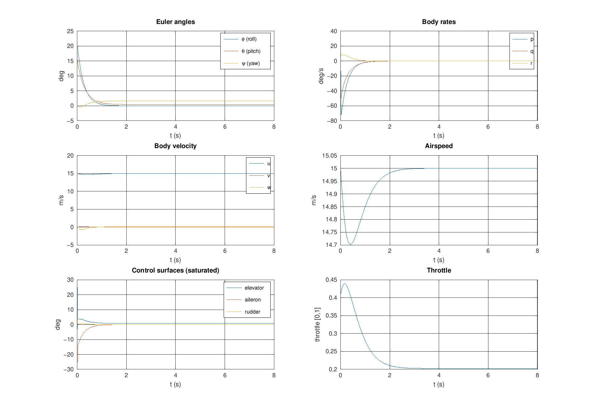
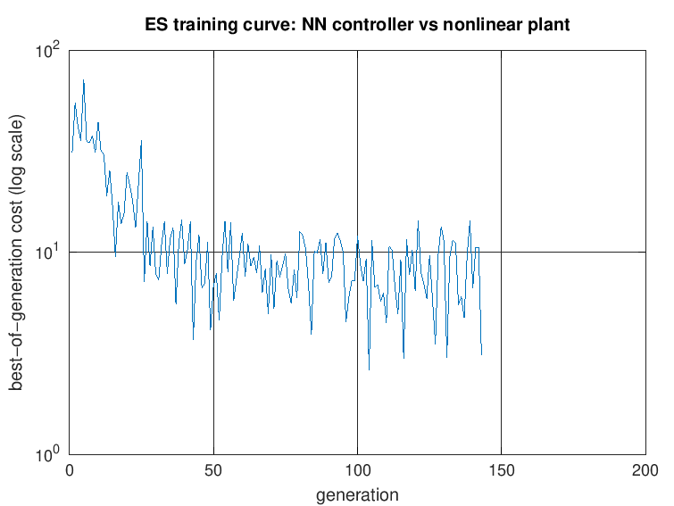
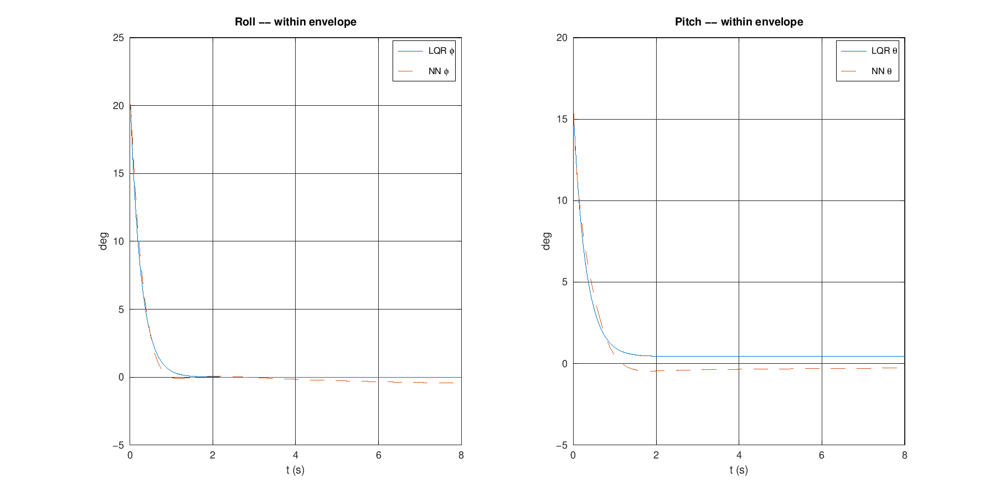
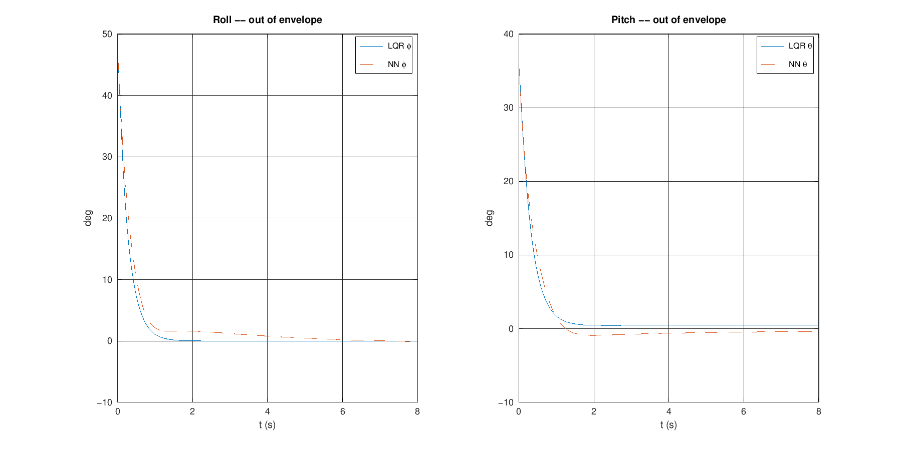

# flightctl — design write-up

## 1. What this is

A full-envelope-adjacent (small-perturbation) 6-DOF fixed-wing flight
controller, built twice: once as a MATLAB/Octave reference implementation
used for design and analysis, and once as an independent, real-time-capable
C++ implementation, with a verification harness proving the two agree.
A from-scratch neural-network controller, trained directly against the
nonlinear plant with a simple evolution strategy (no autodiff, no deep
learning toolbox, no GPU), is compared head-to-head against the classical
LQR baseline on the identical cost function.

Airframe: a representative small fixed-wing UAV (~2.5 kg, ~2.1 m span).
The mass/geometry/inertia are self-consistent; the aerodynamic stability
derivatives are illustrative values chosen to be physically plausible for
this class of airframe, not copied from a specific real aircraft's
flight-test data — see the header comment in `matlab/aircraft_params.m`.
Swap them for identified values to model a real airframe; nothing else in
the project depends on which numbers are in that one file.

## 2. The nonlinear model

`matlab/dynamics_six_dof.m` / `cpp/src/dynamics.cpp` implement the standard
12-state rigid-body equations: NED position, body-frame velocity, Euler
attitude, body-frame angular rate. The kinematics (position rate from body
velocity via the body->NED rotation matrix; Euler-angle rates from body
rates) and the Newton-Euler force/moment balance (including the Jxz
product-of-inertia cross-coupling term in the rotational dynamics) are
exact — no small-angle assumption anywhere in that part of the model. The
only linearization in the whole nonlinear model is in the aerodynamic
coefficients themselves (CL, CD, Cm, Cl, Cn as affine functions of
alpha/beta/rates/controls), which is accurate for the attached-flow, small
alpha/beta regime this project trims and disturbs around, and intentionally
does not model stall or separated flow.

## 3. Trim, linearization, LQR

`trim_aircraft.m` solves a 3-equation/3-unknown nonlinear system (alpha,
elevator, throttle) via `fsolve` for straight-and-level flight at 15 m/s,
converging to a residual norm of 5.8e-15. `linearize_model.m` computes the
state-space `A`, `B` by central finite differences on the full nonlinear
dynamics.

**Deliberate scope boundary:** 4 of the 12 states — inertial position
(pn, pe, pd) and heading (psi) — have identically zero columns in `A`
and `B`: nothing in this flat-earth model's force/moment balance depends on
*where* the aircraft is or *which way it's pointed*. Folding them into one
monolithic 12-state LQR would hand the Riccati solver marginally-stable
(eigenvalue-zero), uncontrollable modes, which violates the stabilizability
condition LQR relies on. So `design_lqr.m` solves LQR on the reduced
8-state inner loop (`u v w phi theta p q r`) and zero-pads the gain back
out to 4x12 — exactly mirroring how a real autopilot splits an inner
attitude/rate loop from an outer guidance loop (track/altitude/heading
hold, commanding roll/pitch references) rather than one undifferentiated
regulator. This project implements the inner loop only; the outer loop is
out of scope and is not something the controller does badly — it's
something it was not asked to do.

Closed-loop eigenvalues (reduced 8-state system) are all strictly
negative-real-part — locally stable about trim, as checked and asserted in
`run_design_and_export.m`.

### Disturbance-rejection result

Initial-condition disturbance: 20° bank, 15° pitch, 30/10/15 deg/s
roll/pitch/yaw rate, simulated on the full nonlinear plant (not the
linearization) for 8 s at a 400 Hz control rate:

- Roll and pitch — the two states this inner loop actually regulates —
  settle to the trim condition to within floating-point noise by ~2.5 s.
- Heading drifts by 1.62° and *stays there* — correct, expected behavior
  for a state this controller deliberately does not feed back, not a bug.
  (An earlier version of this check compared full 3-axis attitude error and
  flagged "not settled" — that was a bug in the *check*, not the
  controller; fixed once the heading-drift state was separated out.)

## 4. The from-scratch NN controller

`matlab/nn_policy.m`: an 8→24→24→4 feedforward network, tanh hidden
activations, output layer mapped directly through `tanh`/sigmoid-style
functions scaled to each actuator's physical limits — so the network can
*structurally never* command an out-of-range surface deflection or an
out-of-[0,1] throttle, independent of training quality. Weights are
warm-started (not randomly initialized from scratch) so that at zero input
error the network's output lands near the LQR's trim condition — otherwise
a random policy is overwhelmingly likely to be unstable from step one, and
the search would spend most of its budget just discovering that flight is
possible at all.

### Training method: a from-scratch evolution strategy

No autodiff library, no backprop-through-the-ODE (which would need adjoint
sensitivity analysis), no GPU. `train_es.m` implements a plain
(mu/mu_w, lambda) evolution strategy: each generation, sample `lambda=24`
candidate parameter vectors around the current mean, evaluate each on the
*same* randomly-drawn batch of disturbed initial conditions (shared across
candidates within a generation — a standard variance-reduction trick, so
cost differences reflect policy quality rather than which candidate got an
easier disturbance), rank-weighted-recombine the best `mu=8` into a new
mean. Elitism (tracking the single best candidate ever seen, separately
from the recombination mean) was added partway through training after
observing the recombination mean actively regress once step size got small
— see the training log in §6 for the real tuning story, kept rather than
cleaned up, because it's the actual engineering process.

Training ran 143 generations (~35 minutes total, in several resumable
checkpointed sessions — `train_es.m` is designed to be called repeatedly
and pick up from `matlab/checkpoints/nn_controller_checkpoint.mat`), best
cost dropping from the 30-70 range in the first few generations to 2.61:

### Head-to-head result: LQR wins, and here's why that's the right answer

Both controllers are scored by the *identical* quadratic cost (same
`Q_reduced`, `R` used for the LQR design itself) on the nonlinear plant —
apples to apples, not two different metrics invented to flatter either one.

| Scenario | LQR cost | NN cost | NN / LQR |
|---|---:|---:|---:|
| Within training envelope (same disturbance as §3) | 8.30 | 11.86 | 1.43 |
| Out-of-envelope generalization (45° bank / 35° pitch / 60-40-45 deg/s, ~1.5-2x the training envelope) | 44.40 | 57.71 | 1.30 |

The NN controller does not diverge in either test, and tracks the LQR
response closely (see the overlaid plots) — it clearly learned *something*
real about stabilizing this aircraft, not a degenerate policy. But it does
not beat LQR, in either scenario, and **that is the theoretically expected
result, not a disappointing one**: LQR is the *provably optimal* solution
to exactly this quadratic cost on the linearized dynamics, and this
project's whole disturbance envelope keeps alpha/beta small enough that the
linearization stays a good model of the true nonlinear plant (the
aerodynamic coefficients are affine by construction — see §2 — so there
isn't a large "nonlinearity bonus" sitting on the table for a learned
policy to capture here). Expecting a generic from-scratch MLP trained with
a few dozen minutes of black-box optimization to beat the closed-form
optimal solution to its own cost function would be the surprising claim;
correctly predicting it wouldn't, and then showing the actual numbers by
how much, is the point of running the comparison in the first place. A
regime where a learned controller has real room to win is a more strongly
nonlinear one (stall, large-angle maneuvering, actuator/sensor faults) —
out of scope for this project's aerodynamic model, and exactly the kind of
scenario project 2 (sensor fault / spoofing detection) is aimed at instead.

## 5. The C++ port and the real-time story

`cpp/` is an independent reimplementation — not a MATLAB Coder / Simulink
autogeneration — of the nonlinear dynamics, the fixed-step RK4 integrator,
and both controllers (LQR and the trained NN, loading the exact weights
`matlab/evaluate_compare.m` exported). `cpp/include/params.hpp` loads every
aircraft constant from the *same* CSV MATLAB exports from its own
`aircraft_params()` struct (`matlab/export_params_csv.m`) — there is
exactly one source of truth for the airframe, never two independently
hand-typed constant tables that could silently drift apart.

Measured real-time headroom (control-loop budget at 400 Hz = 2.5 ms/step,
against actual measured compute time per step in this sandboxed build
environment, which has noisy, shared CPU — take the absolute nanosecond
numbers as order-of-magnitude, not a hardware benchmark): consistently in
the **200x-4000x** range across repeated runs for both controllers, i.e.
comfortably real-time-capable with enormous margin even before any
optimization. The NN controller's forward pass (fixed-size matrix-vector
products, no dynamic allocation) and the LQR controller's gain multiply are
both cheap enough that the dynamics integration itself dominates compute
time in every measurement.

## 6. The verification harness, and the two real bugs it caught

`verification/compare_trajectories.m` is the actual point of building this
twice: it diffs the MATLAB- and C++-generated trajectories for two test
cases (LQR and NN controllers) state-by-state and control-by-control, and
only declares PASS if every column agrees within `1e-6` absolute — which,
for two independent double-precision RK4 implementations of the same
fixed-step integration, should mean agreement far tighter than that if both
sides are honestly correct. This is the same "two independent
implementations of the same spec, cross-checked" pattern used in real
safety-critical flight software.

It is not a clean story, and that's worth keeping rather than editing out:

**Bug 1 — NN weight unpacking, wrong memory layout.** The first C++ port of
`nn_policy.m`'s forward pass indexed each weight matrix row-major (the
instinctive C++ layout). MATLAB/Octave's `reshape(theta, nout, nin)` fills
**column-major**. The two layouts silently produce *a* valid-looking
weight matrix either way — nothing crashes — just the wrong one. First
verification run: every physical state off by order-1 to order-100 within
a couple of seconds of simulated time (NN case diverged from the MATLAB
reference almost immediately). Fixed by correcting the flattened-index
formula from `o*nin + i` to `i*nout + o`; re-verified to machine precision
(`<5e-15` absolute error, every state, every control) on the next run. The
LQR case — which doesn't have this pack/unpack step, the gain matrix is
loaded directly from CSV — matched to machine precision from the first
attempt, which in hindsight was the tell that the bug was specifically in
the NN weight-loading path, not the shared dynamics/RK4 code both
controllers depend on.

**Bug 2 — two of my own MATLAB scripts logged the control at different
points in the loop.** After fixing bug 1, the NN case passed perfectly but
the *LQR* case started failing — only on the four control channels, with
every physical state still matching to machine precision. That pattern (all
states exact, only logged controls wrong) means the actual integration was
always correct on both sides; something was wrong purely in what got
*written down*. `rollout_cost.m` (used for the NN case) logs `U(:,j) =
ctrl(X(:,j))` — the control law evaluated at that same row's state, for
every row including a fresh post-loop evaluation at the final state.
`run_design_and_export.m` (used for the LQR case) had been written
independently, earlier, with the opposite convention: `U(:,k+1)` was the
control that *produced* `X(:,k+1)` from the previous state — off by one
sample from the other script's convention. The C++ side had been written to
match `rollout_cost.m`'s convention, so it agreed with the NN case and
disagreed with the LQR case, for a reason that had nothing to do with
either controller and everything to do with two MATLAB scripts not
agreeing with each other. Fixed by standardizing `run_design_and_export.m`
onto the same "log the control evaluated at this row's own state"
convention; re-verified, both cases now pass to machine precision (see
`verification/compare_trajectories.m`'s output, reproduced in the README).

Both of these are exactly the class of bug a verification step is supposed
to catch and a casual "the plots look about right" check would have missed
completely — the within-envelope comparison plots in §4 would have looked
indistinguishable whether bug 1 was fixed or not, because the divergence
only shows up when you diff the actual numbers, not when you eyeball a
chart.

## 7. Known limitations / explicitly out of scope

- No outer guidance loop (position/heading hold) — by design, see §3.
- No wind/gust model — the robustness test here is initial-condition
  disturbance rejection, not gust rejection. Would be a small addition
  (a wind-velocity input to `dynamics_six_dof`, subtracted from body
  velocity before computing Va/alpha/beta) and a natural next step.
- Aerodynamic model is affine in alpha/beta/rates/controls — valid for the
  small-perturbation regime this project operates in, not stall or
  post-stall.
- No actuator dynamics (surfaces are treated as instantaneous, only
  position-limited, not rate-limited).
